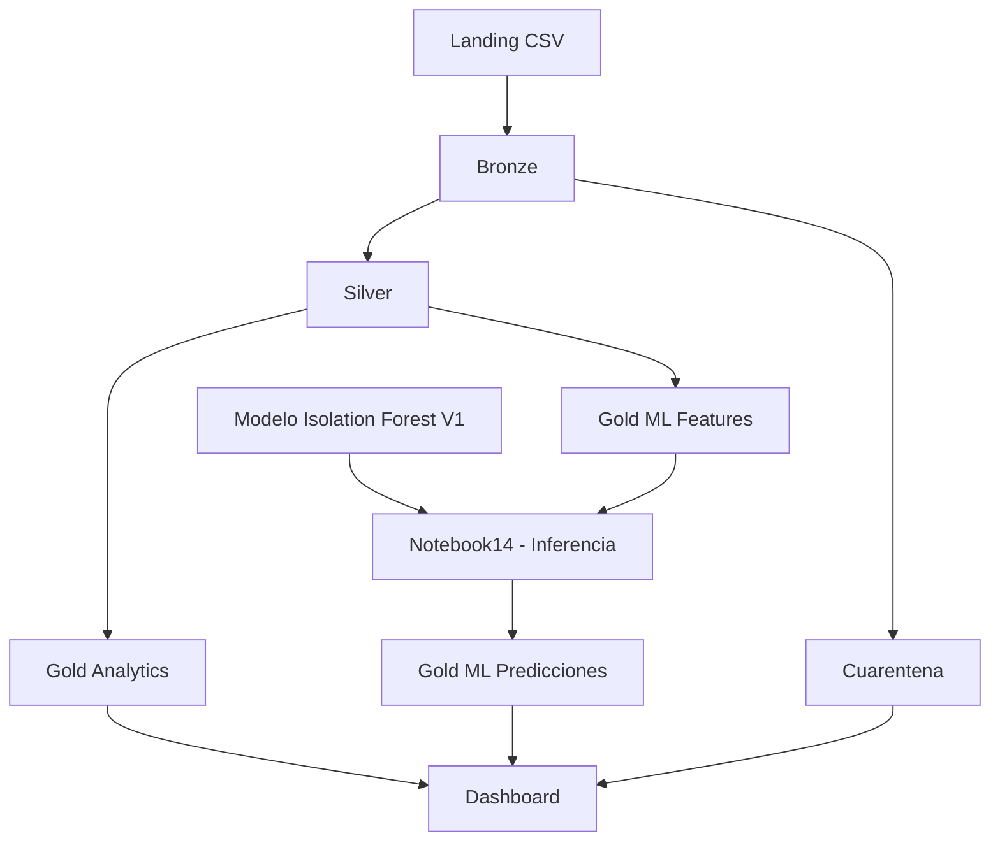

# OceanWatch Analytics — Pipeline ETL

## Objetivo

Implementar arquitectura Medallón incremental en Databricks para telemetría AIS, calidad de datos, indicadores y preparación de Machine Learning.

## Componentes

| Script | Salida |
|---|---|
| [01 Bronze](README_01_Ingesta_Bronze_AIS.md) | ais_bronze |
| [02 Silver](README_02_Bronze_Silver_AIS.md) | ais_silver, ais_silver_cuarentena |
| [03 Gold Analytics](README_03_Gold_Analytics.md) | Tres vistas materializadas activas |
| [04 Gold ML Features](README_04_Gold_ML_Features.md) | ais_gold_ml_features |

## Linaje

## Ejecución y orquestación

Los cuatro scripts se configuran en el pipeline declarativo con destino `workspace.oceanwatch`. Según la configuración del Job reportada durante el proyecto, `Job_Oceanwatch_AIS` ejecuta `ETL_Oceanwatch`, luego `ML_Inferencia` (Notebook14) y finalmente `Actualizar_Dashboard_AIS`. El File Arrival Trigger monitorea `/Volumes/workspace/oceanwatch/ais_landing/incoming/`. La configuración del Job y del dashboard no forma parte de los cuatro scripts entregados.

## Prueba funcional final reportada

| Indicador | Valor acumulado |
|---|---:|
| Silver | 60.444.266 |
| Cuarentena | 259.293 |
| Predicciones | 22.012.997 |
| Anomalías | 284.544 |

El último lote de 10.000 registros válidos produjo 3.571 predicciones y 56 anomalías. Son resultados reportados en la conversación, no una ejecución realizada durante la documentación. No prueban precisión predictiva ni correspondencia fila a fila.

## Consideraciones operativas

- Conservar checkpoints y evitar ejecuciones concurrentes de notebooks 13 y 14.
- No ejecutar Full Refresh sin coordinar la reconstrucción de predicciones.
- El modelo registrado es una dependencia externa al código ETL.
- Las capas geográficas de notebooks 4 y 5 no se utilizan en las reglas activas de este pipeline.
- El trigger puede pausarse para controlar consumo de recursos; verificar su estado antes de publicar archivos.
