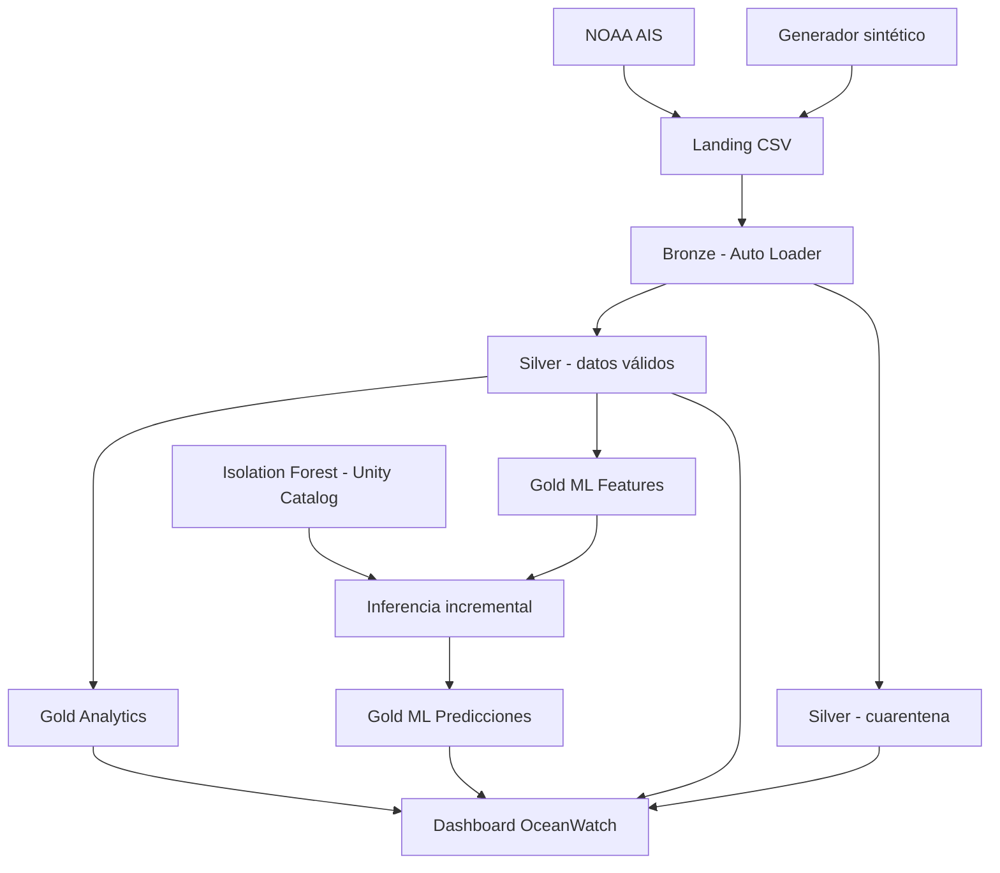
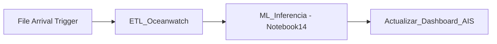

# OceanWatch Analytics

Plataforma de ingeniería y analítica de datos marítimos basada en Databricks, orientada al procesamiento de registros AIS (Automatic Identification System), el control de calidad de la información y la detección de observaciones anómalas mediante Machine Learning.

## 1. Objetivos

- Ingerir y almacenar grandes volúmenes de telemetría AIS de NOAA.
- Caracterizar la actividad marítima mediante análisis exploratorio y geoespacial.
- Implementar una arquitectura Medallón con procesamiento incremental, trazabilidad y reglas de calidad.
- Detectar observaciones atípicas mediante Isolation Forest.
- Automatizar el procesamiento y la actualización de indicadores ante la llegada de nuevos archivos.

## 2. Fuentes de datos

| Fuente | Descripción |
|---|---|
| [NOAA AIS](https://coast.noaa.gov/htdata/CMSP/AISDataHandler/2023/) | Histórico del 1 al 7 de junio de 2023: 60.533.559 observaciones, aproximadamente 6,04 GB. |
| Límites terrestres y marítimos de Estados Unidos | Cobertura geográfica integrada en EPSG:4326 para selección de puertos. |
| World Port Index | Inventario de puertos; selección final de 695 puntos mediante criterios espaciales y de atributos. |
| Datos sintéticos | Lotes derivados de Silver para pruebas de calidad y procesamiento incremental. |

Las capas geográficas constituyen un componente complementario de análisis; no intervienen en las reglas activas del ETL ni en la selección espacial de observaciones para el modelo.

## 3. Arquitectura de la solución



La solución utiliza Unity Catalog (`workspace.oceanwatch`) para organizar tablas, volúmenes y el modelo registrado. El almacenamiento histórico optimizado en Delta particionado por fecha es independiente de las tablas declarativas del pipeline operativo.

## 4. Tecnologías

| Tecnología | Aplicación |
|---|---|
| Databricks y Unity Catalog | Ejecución, almacenamiento y gobernanza |
| Apache Spark / PySpark | Procesamiento distribuido y agregaciones |
| Auto Loader / Spark Structured Streaming | Ingesta e inferencia incremental |
| Lakeflow Spark Declarative Pipelines | Transformaciones Medallón |
| Delta Lake / Parquet | Almacenamiento columnar y optimización |
| scikit-learn / MLflow | Isolation Forest, experimentación y registro del modelo |
| pandas / NumPy / cloudpickle | Inferencia por lotes distribuidos |
| GeoPandas / QGIS / Folium | Preparación y exploración geoespacial |
| Databricks Jobs y AI/BI Dashboards | Orquestación y visualización |

## 5. Pipeline ETL

| Capa | Tabla o vista | Función |
|---|---|---|
| Bronze | `ais_bronze` | Ingesta CSV incremental, conservación de 17 atributos originales como texto y metadatos de origen. |
| Silver | `ais_silver` | Validación, tipificación, normalización y enriquecimiento de tipos de embarcación. |
| Silver | `ais_silver_cuarentena` | Registros rechazados con códigos, motivos y fecha de validación. |
| Gold | `ais_gold_indicadores` | Indicadores generales acumulados. |
| Gold | `ais_gold_tipos_embarcacion` | Agregaciones por tipo de embarcación. |
| Gold | `ais_gold_categorias` | Agregaciones por categoría. |
| Gold | `ais_gold_ml_features` | Observaciones elegibles para Machine Learning. |
| Gold (inferencia) | `ais_gold_ml_predicciones` | Resultados del modelo y trazabilidad de inferencia. |

### Reglas críticas de calidad

| Regla | Validación |
|---|---|
| RGN_S02 | MMSI de exactamente nueve dígitos numéricos. |
| RGN_S03 | Fecha AIS convertible a timestamp. |
| RGN_S04 | Latitud entre -90 y 90. |
| RGN_S05 | Longitud entre -180 y 180. |
| RGN_S06 | SOG entre 0 y 40 nudos. |

Silver normaliza atributos secundarios y enriquece `VesselType` mediante un diccionario de códigos 0–99. Gold ML exige además completitud y rangos válidos de las ocho variables del modelo. Una observación válida en Silver puede no ser elegible para ML sin que esto constituya un rechazo de calidad crítico.

## 6. Machine Learning

Se utiliza Isolation Forest, un modelo no supervisado para identificar combinaciones atípicas de atributos AIS. El modelo operativo está registrado en Unity Catalog:

```text
models:/workspace.oceanwatch.ais_isolation_forest/1
```

Variables: `SOG`, `Length`, `Width`, `LAT`, `LON`, `COG`, `Heading` y `VesselType`.

Según los experimentos realizados durante el proyecto, el modelo incorpora transformación circular de los ángulos, codificación one-hot del tipo de embarcación y 200 árboles con 256 muestras por árbol. Se calibraron umbrales del percentil 1 global y por tipo de embarcación, habilitando el umbral por tipo cuando había al menos 1.000 registros de entrenamiento de esa categoría.

| Código | Clasificación | Interpretación |
|---|---|---|
| 0 | Normal | No supera los criterios de anomalía disponibles. |
| 1 | Solo_global | Score inferior únicamente al umbral global. |
| 2 | Solo_categoria | Score inferior únicamente al umbral de su tipo. |
| 3 | Ambas | Score inferior a ambos umbrales. |

La inferencia carga el modelo registrado, ejecuta `mapInPandas` sobre los datos nuevos y escribe resultados Delta en modo append con `availableNow` y checkpoint persistente. El score no representa una probabilidad ni una medida de gravedad. El entrenamiento no forma parte de los notebooks finales distribuidos; se requiere acceso al modelo registrado para reproducir la inferencia.

## 7. Orquestación automática

El Job `Job_Oceanwatch_AIS` ejecuta las siguientes tareas en orden, condicionadas al éxito de la anterior:



Directorio monitoreado:

```text
/Volumes/workspace/oceanwatch/ais_landing/incoming/
```

El Job procesa los archivos nuevos, ejecuta la inferencia y refresca el dashboard publicado. El estado del trigger debe verificarse antes de publicar nuevos lotes.

## 8. Dashboard

`Dashboard_OceanWatch` consolida tres páginas:

- **Indicadores_AIS:** posiciones, embarcaciones únicas, tipos, categorías y evolución temporal.
- **Cuarentena_AIS:** cantidad y proporción de registros rechazados y motivos de rechazo.
- **Deteccion_Anomalias:** observaciones evaluadas, anomalías, tasa, embarcaciones afectadas, evolución temporal y detalle de observaciones anómalas.

## 9. Resultados funcionales

Resultados acumulados reportados después de la última prueba incremental:

| Indicador | Resultado |
|---|---:|
| Observaciones válidas en Silver | 60.444.266 |
| Registros en cuarentena | 259.293 |
| Embarcaciones únicas | 31.718 |
| Observaciones evaluadas por ML | 22.012.997 |
| Observaciones anómalas | 284.544 |
| Tasa acumulada de anomalías | 1,29 % |

En la última prueba se generaron 10.000 registros sintéticos sin errores críticos. Los 10.000 ingresaron a Silver, 3.571 fueron evaluados por ML y 56 se clasificaron como anómalos (1,57 % de los evaluados). El dashboard reflejó los incrementos.

También se comprobó previamente el procesamiento de lotes con errores controlados y la estabilidad de los conteos de inferencia al repetir una ejecución sin datos nuevos.

Estos resultados corresponden a pruebas reportadas durante el desarrollo, no a una nueva ejecución. Demuestran funcionamiento incremental, pero no precisión predictiva: no se dispone de etiquetas de referencia y el generador no inyecta anomalías ML deliberadamente.

## 10. Documentación y estructura del repositorio

Estructura propuesta: colocar los README individuales junto a sus respectivos notebooks y scripts, manteniendo las carpetas `notebooks/` y `pipeline/` del paquete de documentación.


### Notebooks

- [Notebook 1 – Ingesta de datos](Notebooks/README_OceanWatch/README_Notebook1_IngestaDatos.md)
- [Notebook 2 – Exploración, perfilamiento y preguntas de negocio](Notebooks/README_OceanWatch/README_Notebook2_ExplorPerfil_PregNeg.md)
- [Notebook 3 – Almacenamiento y optimización](Notebooks/README_OceanWatch/README_Notebook3_AlmacenamOptimizacion.md)
- [Notebook 4 – Límites marítimos y terrestres de Estados Unidos](Notebooks/README_OceanWatch/README_Notebook4_Capa_limitesMarítimos_US.md)
- [Notebook 5 – Selección de puertos de Estados Unidos](Notebooks/README_OceanWatch/README_Notebook5_OrganizacionPuntos_puertos_US.md)
- [Notebook 6 – Administración de Unity Catalog](Notebooks/README_OceanWatch/README_Notebook6_Admin_UnityCatalog.md)
- [Notebook 7 – Descarga AIS para Landing](Notebooks/README_OceanWatch/README_Notebook7_Descarga_AIS.md)
- [Notebook 10 – Generación de datos sintéticos](Notebooks/README_OceanWatch/README_Notebook10_GeneracionDatos_Sinteticos.md)
- [Notebook 13 – Desarrollo y validación de inferencia ML](Notebooks/README_OceanWatch/README_Notebook13_ML_Inferencia.md)
- [Notebook 14 – Inferencia ML en producción](Notebooks/README_OceanWatch/README_Notebook14_ML_Inferencia_Prod.md)


### Pipeline ETL

- [Documentación general del pipeline](Pipeline/README/README_General_Pipeline.md)
- [01 – Ingesta Bronze AIS](Pipeline/README/README_01_Ingesta_Bronze_AIS.md)
- [02 – Transformación Bronze a Silver](Pipeline/README/README_02_Bronze_Silver_AIS.md)
- [03 – Gold Analytics](Pipeline/README/README_03_Gold_Analytics.md)
- [04 – Gold ML Features](Pipeline/README/README_04_Gold_ML_Features.md)


## 11. Puesta en funcionamiento

1. Configurar el catálogo, esquema, volúmenes y permisos necesarios en Databricks.
2. Preparar el almacenamiento histórico y los recursos geográficos si se requiere reproducir la exploración inicial (notebooks 1–5).
3. Preparar Landing con el Notebook 6 y configurar los cuatro scripts del pipeline con destino `workspace.oceanwatch`.
4. Publicar los archivos AIS con el Notebook 7 y ejecutar el pipeline.
5. Verificar acceso al modelo registrado versión 1 y configurar el Notebook 14 como tarea de inferencia.
6. Configurar el dashboard y las dependencias del Job; habilitar el File Arrival Trigger cuando corresponda.
7. Utilizar el Notebook 10 para pruebas incrementales controladas y el Notebook 13 para desarrollo y validación de inferencia.

## 12. Consideraciones operativas y alcance

- Los notebooks 13 y 14 comparten checkpoint y tabla de destino: no deben ejecutarse concurrentemente.
- No eliminar checkpoints ni ejecutar Full Refresh sin coordinar la reconstrucción de las predicciones.
- Los registros sintéticos reutilizan atributos históricos; no garantizan anomalías nuevas ni elegibilidad ML.
- La vista `ais_gold_velocidades` está deshabilitada en el script final.
- Las reglas de calidad activas no incluyen deduplicación ni filtrado por límites marítimos.
- La configuración del Job, el dashboard y el modelo registrado son recursos del workspace; no están incluidos como artefactos desplegables en los scripts entregados.
- Se conserva la numeración original de los notebooks definitivos, excluyendo los notebooks de pruebas no entregados.
